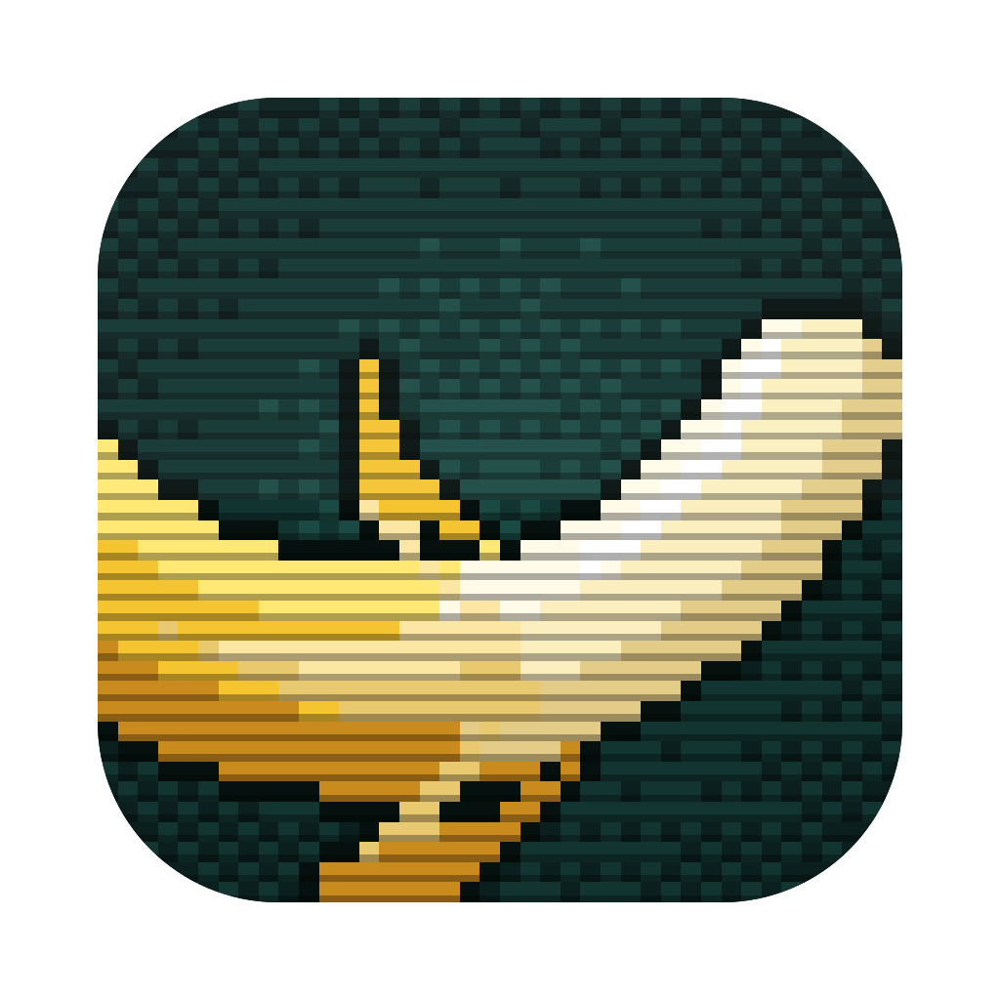

<p align="center">
  
</p>

<h1 align="center">Imagen</h1>

A lightweight, single-user **image-to-image** web app powered by Google Vertex AI (Nano Banana models).

- Upload reference images, edit prompts, choose model / aspect ratio / resolution
- **ADC** authentication — no API keys stored; only Project ID + Location in local SQLite
- **Image library** with dedup (sha256) and lineage tracking
- **Generation history** — one-click reuse of prompts + reference images
- **Queue** with delayed send, cancellation, configurable concurrency, live status
- **Persistent drafts** with input/output attachments, pinning, inline prompt editing, and safe queue/copy/move actions
- English / Chinese UI (localStorage)


## Prerequisites

The app authenticates to Vertex AI via **ADC (Application Default Credentials)** — no API keys needed.

```bash
gcloud config set project <your-project>
gcloud services enable aiplatform.googleapis.com
gcloud auth application-default login
gcloud auth application-default set-quota-project <your-project>
```

The account needs the `Vertex AI User` role. After starting the app, open **Settings** and fill in your Project ID and Location.

## Tech Stack

- **Frontend:** React + Vite (TypeScript), no-dependency i18n
- **Backend:** Python + FastAPI, [`google-genai`](https://pypi.org/project/google-genai/) SDK via Vertex AI
- **Storage:** local filesystem (sha256 dedup + WebP thumbs), metadata in SQLite

## Quick Start

```bash
cd backend && uv sync                                    # Python deps
cd ../frontend && npm install                            # JS deps

# Dev (two terminals):
cd backend && uv run uvicorn app.main:app --reload --port 8000
cd frontend && npm run dev                               # → http://localhost:5173

# Production:
cd frontend && npm run build
cd backend && uv run uvicorn app.main:app --port 8000    # → http://localhost:8000
```

## Desktop App (macOS)

`Imagen.app` is a Tauri shell around the same FastAPI backend and React UI. The
backend is bundled, so the desktop app does not need Docker or a terminal.

### Requirements

- macOS 15 (Sequoia) or newer
- Apple Silicon (`arm64` / `aarch64`)
- For source builds: Xcode command line tools, Rust, Node.js, and `uv`

### Build from source

From the repository root:

```bash
desktop/build.sh          # builds Imagen.app
desktop/build.sh --dmg    # builds the app and Imagen_<version>_aarch64.dmg
```

The app is written to
`desktop/src-tauri/target/aarch64-apple-darwin/release/bundle/macos/Imagen.app`.
The DMG is written to the sibling `bundle/dmg/` directory. The build checks that
the backend, desktop package, Cargo manifest, and Tauri config versions agree.

### Data, logs, and port

The app does **not** create or copy a library by default. On first launch it
asks you to open an existing library or create a new one; that folder becomes
the library in place. To create one, choose an empty folder (or make a new empty
folder in the picker).

- Config: `~/.config/imagen/desktop.json`
  - `{"version":1,"library":"/absolute/path/to/library"}`
- Page zoom: View menu — `实际大小` (⌘0), `放大` (⌘= or ⌘+), `缩小` (⌘-).
  - Remembered in `~/.config/imagen/ui.json` as `{"version":1,"zoom":1.25}`.
- Logs: `~/.config/imagen/logs`
  - `backend.log`, `shell.log`
- Library: the folder you choose
  - `app.db`, `images/`, `thumbs/`, plus `backups/` and `.imagen.lock`
- Backend: `127.0.0.1:47860` (loopback only; no network exposure)

Set `IMAGEN_CONFIG_PATH` to use a different config file (useful for tests).
Set `IMAGEN_DATA_DIR` to run in test mode with a throwaway library; test mode
does not read `desktop.json`, but still validates/locks/backs up an existing
`app.db`. Either variable also disables the single-instance and window-state
plugins, so a test instance cannot touch the real app-support directory.

For a test library, `IMAGEN_LIBRARY_MODE=existing` refuses to initialize, and
`create` requires a missing or empty folder. The desktop shell chooses one mode
automatically; the default `auto` (used by test scripts) treats a folder with
`app.db` as existing and anything else as new. Validation failures exit with
code 3, and a library already in use exits with code 4.

### Background mode and the menu bar

Closing the window (⌘W or the red button) no longer quits: Imagen keeps running
from the menu bar. The Dock icon disappears, the menu bar keeps an icon, and
remote devices keep working — queued generations keep running too.

- Click the icon for a dashboard: remote access on/off, the address and access
  code, signed-in devices, and how many generations are running.
- Right-click it for Open Imagen (⌘D), Remote access, or Quit Imagen (⌘Q).
- ⌘D, Finder, or Spotlight brings the window back as a normal app.

⌘Q still quits, but while generations are running it asks you to hold ⌘Q for
about a second ("Hold ⌘Q to quit"). Choosing Quit from a menu exits immediately.

### Unsigned build

The app is **not signed with a Developer ID and is not notarized**. Other people
should build it from source. If you received a `.app` from somewhere else,
remove the quarantine attribute once before opening it:

```bash
xattr -dr com.apple.quarantine /Applications/Imagen.app
```

Gatekeeper may still require **System Settings → Privacy & Security → Open
Anyway** depending on how the file was transferred.

### Homebrew (after release)

Once a GitHub release and the tap exist, the intended install command is:

```bash
brew install --cask gitkeniwo/imagen/imagen   # available after release
```

### Using an existing library (from Docker or elsewhere)

1. Stop the Docker container: `docker compose down`.
2. Open `Imagen.app` and choose **打开已有图库… / Open Existing Library…**.
   Point it at the **host folder** that Docker mounted as the data directory
   (for example the `./imagen-data` or `backend/data` folder from your compose
   file).
3. The database and images are used **in place**. Nothing is copied or migrated.
   The app validates the folder, backs up `app.db` once per day before opening
   it, and writes only `backups/` and `.imagen.lock` inside the library.

Docker and the desktop app can take turns using the same library, but they
**must not run at the same time**. The `.imagen.lock` file only guards desktop
instances; it cannot see a Docker container. Run `docker compose down` before
opening the app, and quit the app before starting Docker.

If the library lives in Documents, Desktop, iCloud Drive, or on an external
disk, macOS may ask for permission the first time. Grant it to `Imagen`; if you
move or unmount the disk, the app shows an error page with a retry button and
does **not** create a new empty library there.

### System proxy

An app launched from Finder does not inherit `HTTPS_PROXY` from a shell. The
backend uses Python's system-proxy lookup, so macOS system proxy settings and
TUN-style proxies still apply. There is no proxy configuration screen.

### Docker still works

The Docker and desktop paths share the same backend. `docker build`, Compose,
and the GHCR workflow remain supported; the desktop changes do not remove or
replace them.

## Docker

Via GHCR (pre-built image):

```bash
mkdir -p ./imagen-data && docker run -d \
  --name imagen \
  -p 8000:8000 \
  -e IMAGEN_DATA_DIR=/data \
  -e GOOGLE_APPLICATION_CREDENTIALS=/gcloud/adc.json \
  -v ./imagen-data:/data \
  -v ~/.config/gcloud/application_default_credentials.json:/gcloud/adc.json:ro \
  ghcr.io/gitkeniwo/imagen:latest
```

Or build locally with compose:

```bash
docker compose up --build -d     # → http://localhost:8000
```

## Migrating to a New Machine

Three things make up this app, and two of them live **outside the repo**:

1. **The project itself** — copy the whole directory (or `git clone` it). Note that `docker-compose.yml` is gitignored: if you customized it (e.g. data paths), bring it along, or recreate from `docker-compose.example.yml`.

2. **Your data** — the SQLite database (`app.db`: generation history, drafts, and your saved Project ID/Location) plus the image library and thumbnails. They live in the data directory you mounted (e.g. `./imagen-data`, or `backend/data` with compose), never in git. Copy the entire directory to the same path on the new machine.

3. **ADC (Application Default Credentials)** — the credential file `~/.config/gcloud/application_default_credentials.json` is **machine-local**; it is not part of this repo and does not travel with it. On the new machine, re-run the one-time setup from [Prerequisites](#prerequisites):

   ```bash
   gcloud auth application-default login
   gcloud auth application-default set-quota-project <your-project-id>
   ```

   Use the same Google account that has the `Vertex AI User` role. Re-login is the reliable path — do not try to copy the credential file. Your Project ID/Location are already saved in the database from step 2, so no Settings change is needed.

Your saved data does **not** need modifying; only the machine-local credentials must be recreated.

### If the container doesn't pick up the new credentials

The container mounts the ADC file read-only at startup (`/gcloud/adc.json`). Normally the mount is live — editing the file doesn't require any action. If the app still reports *"No ADC credentials found"*, recreate the container so Docker re-establishes the mount:

```bash
docker compose up -d --force-recreate
```

This never touches your data directory.

## Verification

```bash
cd backend
PROJECT=<your-project> uv run python scripts/probe_gemini.py
```

## Data & Privacy

- All data lives in the mounted volume (`./imagen-data` with the command above, or `./backend/data` with compose).
- Drafts are stored in SQLite; deleting a draft never deletes its attached library images.
- ADC credentials (`~/.config/gcloud/application_default_credentials.json`) are mounted read-only.
- Single-user, no access control — add your own if exposing to a network.
